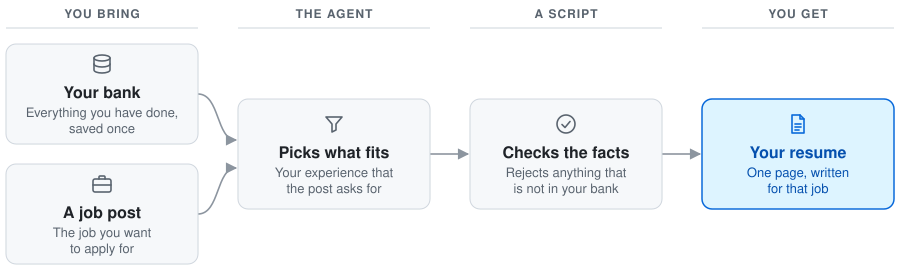

# career-resume-bank

**You have done more than fits on one page. Save all of it once, then get a one-page resume for each job, built from the experience that job asks for.**

<picture>
  <source media="(prefers-color-scheme: dark)" srcset=".github/assets/how-it-works-dark.svg">
  
</picture>

## Why each job needs its own resume

- **One page cannot hold a career.** After a few years, you have more experience than fits, and each job cares about a different part of it.
- **Software reads your resume first.** Most large employers use an applicant tracking system (ATS), and recruiters search it for the words in the job post. If the post says "account management" and your resume says "looked after clients", the search can miss you.
- **Writing one by hand takes hours.** It is also tempting to stretch the truth.

## How it works

You open this folder in an AI coding agent, such as Claude Code, and talk to it.

1. **Tell the agent about your work once.** Share an old resume, or describe your jobs. Everything goes into `bank/`, which has no page limit.
2. **Paste a job post.** The agent picks the experience in your bank that the post asks for. It writes a one-page resume in the wording of the post.
3. **A script checks the PDF.** The script reads the page the way hiring software does. It rejects any employer, date, degree, license, or number that is not in your bank.
4. **You see your gaps.** The agent lists what the post asks for that you lack. The agent never makes up experience.
5. **Your applications stay in one list.** Each job gets a folder, and one page shows what each application needs next.

## What you say to the agent

| You say | The agent does |
| --- | --- |
| "Start my bank", with an old resume | Fills `bank/` and asks for the numbers your resume leaves out |
| A pasted job post, or a link to one | Writes a resume for that job and reports your gaps |
| "I just finished a project" | Adds it to the bank for every later resume |
| "I sent that one", or "I have an interview on Friday" | Records it and shows what each application needs next |

## One person, two resumes

`examples/` holds two made-up people, a nurse and a data engineer. The nurse has one bank and two resumes built from it.

| | General resume | Resume for a nurse manager post |
| --- | --- | --- |
| Opens with | Patient falls and medication safety | Leading shifts, hiring, staffing, and mentoring |
| PDF | [Open](examples/nurse/base/Morgan_Sample_Resume.pdf) | [Open](examples/nurse/jobs/2026-02-03-example-valley-nurse-manager/Morgan_Sample_Resume.pdf) |

The report for the nurse manager post is in [`job.md`](examples/nurse/jobs/2026-02-03-example-valley-nurse-manager/job.md):

- The resume uses all 12 terms from the post that her bank supports.
- The resume meets 8 of the 11 requirements in the post.
- Her gaps are listed, such as a master's degree and experience with a budget.

## Get started

<b>Install the tools first</b>

You need Python 3.10 or later, LaTeX, and poppler, on macOS or Linux. On Windows, use WSL.

- macOS: `brew install --cask basictex && brew install poppler`, then in a new terminal `sudo tlmgr install enumitem`
- Ubuntu: `sudo apt install texlive-latex-recommended texlive-latex-extra texlive-fonts-recommended poppler-utils wamerican`

If these commands are new to you, ask your agent to guide you through them. The script names any tool that is missing.

The skills in `.claude/skills/` are written for Claude Code. `AGENTS.md` holds the same rules for any other agent.

1. On GitHub, click **Use this template** and create a **private** repo. Your bank holds your phone number and your work history. Do not fork this repo, because a fork of a public repo is public.
2. Clone your new repo and open the folder in your agent.
3. Say "start my bank" and share your current resume.
4. Paste a job post. Your resume appears in `jobs/<date>-<company>-<role>/`.
5. Read the resume before you send it.

## Limits

- The resume is one page, in one layout. Longer formats, such as an academic CV, are not supported yet.
- The resume is in English and in Latin script. Other languages are not supported yet. Paper is US Letter by default, and A4 is an option. Locations, phone numbers, and grades print the way your country writes them.
- The script reads your PDF with open-source tools. Nobody has tested the PDF against a specific company's hiring system, so the checks lower the risk of a misread and do not remove it.
- The agent asks you for numbers and never supplies them. A bank with few facts gives a resume with few facts.

## What each folder holds

| Path | Holds |
| --- | --- |
| `bank/` | Everything true about your work. `bank/README.md` describes the format. |
| `base/` | Your general resume, the starting point for every job. |
| `jobs/` | One folder per application, and `jobs/README.md`, the list of all of them. |
| `examples/` | The two made-up people. Delete this folder whenever you like. |
| `scripts/build.py` | The script that makes each PDF and checks it. |
| `AGENTS.md` | The rules the agent follows. |

## Contribute

Open issues and pull requests from a clone that holds no bank. Your private copy holds your phone number and your work history, so never open a pull request from it.

Run `python3 scripts/test_build.py` and `python3 scripts/test_applications.py` before you open a pull request.

## License

MIT
